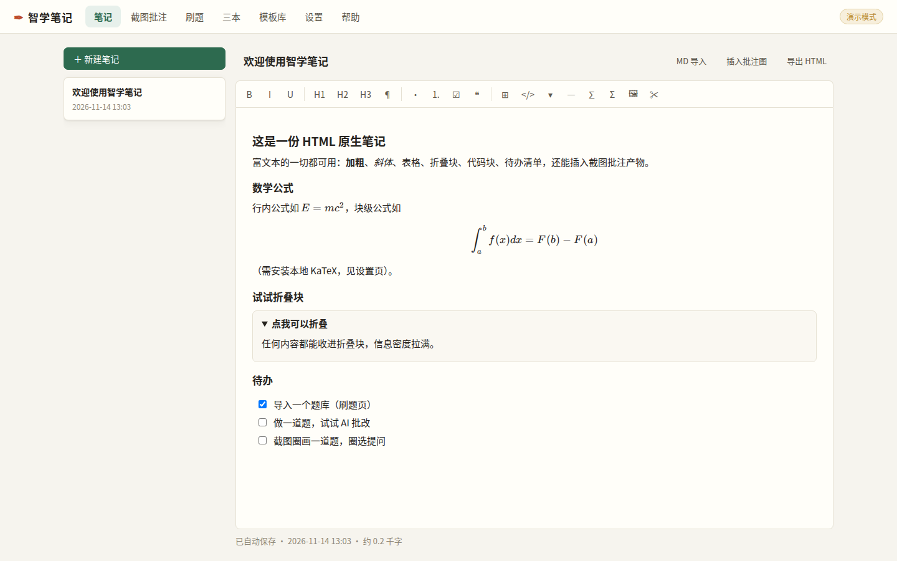
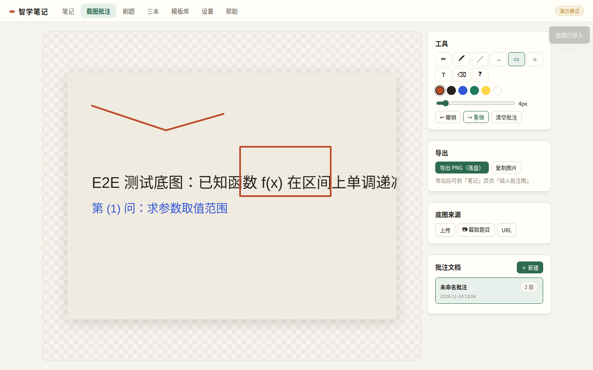

<div align="center">

# ✒️ 智学笔记

**HTML 原生笔记 · 截图圈选批注 · 刷题系统 · 错题/好题/模板本 · 做题模板库（相似度自动归类）**

*零第三方依赖：后端为 Python 标准库，前端为 vanilla JS —— 无框架、无构建、无 pip/npm 安装*

[](https://www.python.org/)
[](#)
[](tests/e2e.js)
[](LICENSE)

</div>

---

## 📸 界面一览

| HTML 原生富文档笔记 | 刷题 + AI 批改报告 |
| :---: | :---: |
|  |  |

| 相似度判定流水线（分数透明 + diff 对照） | 截图圈选批注 |
| :---: | :---: |
|  |  |

## ✨ 功能特性

### 📝 笔记 —— HTML 原生富文档
- 富文本一切皆可用：表格、折叠块、代码块、待办清单、引用、分割线
- 行内 / 块级 **KaTeX 数学公式**（本地 vendor，离线渲染）
- 插入图片（上传 / Ctrl+V 粘贴）、插入批注产物、粘贴 Markdown 自动转富文本
- 一键导出为独立 HTML 文件（直接分享、浏览器即开）

### ✂️ 截图批注
- 底图来源：粘贴 / 上传 / 拖拽 / URL / **html2canvas 一键截取题库题目**
- 图层式 Canvas 编辑器：画笔、荧光笔、直线、箭头、矩形、椭圆、文字、橡皮；颜色线宽可调；撤销重做；图层可回编辑
- 导出 PNG 自动落盘 → 插入笔记或挂到题目
- **圈选提问 AI**：圈出疑难点，直接向多模态模型提问（产物可存档）

### 🎯 刷题系统
- **MD 题库导入**：本地规则解析器离线可用（题号/选项/答案/解析/知识点自动识别，支持拆分纠错预览）；「LLM 智能解析」处理混乱格式
- 作答三模式：文本 / **手写板**（触摸+鼠标）/ 拍照上传（OCR 预留接口）
- **AI 批改**：提示词要求模型先独立解题再对比作答，输出富 HTML 报告（判定、得分、评分细则表、错因分析、改进建议）
- **本质思路 + AI 评价**：提炼题目背后的核心模型与通法
- 知识点标签（AI 建议 + 手动编辑）→ 一键归档 📕错题本 / 📗好题本 / 📘模板本

### 📐 做题模板库 —— 三级相似度流水线
三本中的题目可一键「生成做题模板」；**新题入库前必须先与库内模板比对**：

```
新题 ──▶ ① 归一化签名（数字→占位符、去标点、提取数学要素）
     ──▶ ② 快速召回：bigram-Jaccard + TF-IDF 余弦 + 关键词重叠
     │     （对模板全文与各成员题干分别比对取最高分，top-K 候选）
     ──▶ ③ 精排（可选）：embedding 向量余弦重排
     ──▶ ④ LLM 裁决：{same_type, confidence, reason}，置信度 ≥ 阈值才自动归并
     ──▶ ✔ 归并（触发 LLM 扩容：变式/伪装/解法） 或 ✘ 新建题型
```

**针对「对比算法是否可靠」的四重兜底**：
1. **分数透明**——候选表展示混合分与三项分项（+embedding 分），绝不黑箱
2. **结构对照**——归一化签名的 LCS diff 高亮共同结构，肉眼可验证
3. **阈值卡控 + 人工覆写**——无论裁决结果如何，都可归并到任一候选或坚持新建，覆写记入判定历史
4. **判定历史可回溯**——每个模板记录历次判定的分数与裁决

### 🤖 大模型接入（可调参）
- 任何 **OpenAI 兼容接口**：DeepSeek / 通义 compatible-mode / OpenAI / Moonshot / GLM…
- **8 组提示词全部可视化编辑**（批改 / 本质思路 / 标签 / 模板生成 / 扩容 / 相似度裁决 / 圈选提问 / 题库解析），即改即生效
- 相似度权重与阈值滑杆可调（误归并 → 提高置信阈值；漏归并 → 提高关键词权重）
- 未配置 API 时自动进入**演示模式**：全流程离线可走通，输出明确标注 ⚑
- 所有 AI 产物经**白名单消毒器**过滤后渲染（防提示注入 XSS）

## 🚀 快速开始

```bash
# 无需安装任何依赖
python3 server.py
# 打开 http://127.0.0.1:8765
```

可选参数：`--port 9000 --host 0.0.0.0`

**三步上手**：刷题 → 题库导入 → 「载入示例题库」→ 解析入库 → 做题。

**接入真实 AI**：设置页填写接口地址（如 `https://api.deepseek.com/v1`）、API Key、模型名 → 「连接测试」。Key 仅存本机 `data/config.json`，所有调用经本地服务器代理。

## 🏗️ 架构

```
浏览器 (vanilla JS SPA，无构建) ⇄ Python 标准库服务器 ⇄ OpenAI 兼容大模型 API
                                    ├─ 静态服务（/js /css /vendor）
                                    ├─ 数据 API（data/db.json 全量读写）
                                    ├─ 图片上传（dataURL → data/images/ 落盘）
                                    └─ AI 代理（/api/ai/chat、/api/ai/embed，规避 CORS）
```

```
├── server.py            # 服务器：静态 + 数据 API + 上传 + AI 代理（标准库实现）
├── index.html           # SPA 壳（笔记 / 批注 / 刷题 / 三本 / 模板库 / 设置 / 帮助）
├── design-system.html   # 视觉基准（样式指南）
├── css/app.css          # 设计系统（宣纸 + 墨 + 朱批色板）
├── js/core/             # api / store / sanitize(白名单消毒) / md / katex / ui / app
├── js/ai/               # prompts(可编辑提示词) / provider(AI门面) / mock(演示) / similarity(相似度引擎)
├── js/views/            # notes / annotator / quiz / books / templates / settings / help
├── vendor/              # katex（公式）、html2canvas（截题），已内置
├── sample/              # 示例题库
├── tests/e2e.js         # Playwright 端到端测试（62 项断言）
└── data/                # 运行时数据（自动生成，不入库）
```

## 🧪 测试

```bash
npm i playwright && npx playwright install chromium   # 测试环境
node tests/e2e.js                                     # 18 组场景 · 62 项断言
```

覆盖：应用加载、笔记编辑、XSS 消毒抽查、相似度引擎单元检查、题库导入、作答（文本/手写）、演示 AI 批改、三本归档、模板新建路径、**高相似题归并路径**（召回→diff→裁决→归并→扩容）、批注绘制/撤销/导出、圈选提问、提示词编辑、数据持久化。

## 💾 数据与备份

数据落盘于 `data/`（db.json + config.json + images/）。设置页支持导出 JSON 备份（可选图片内嵌）、导入恢复、清空。

## 📄 许可证

[Apache-2.0](LICENSE)
