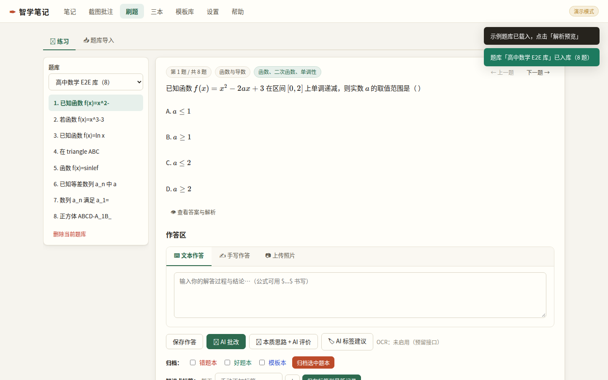
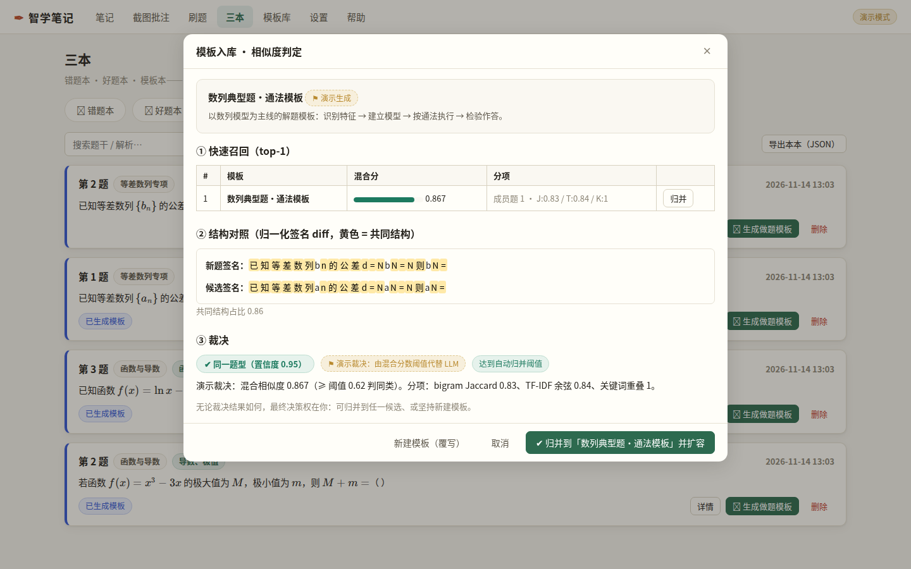

<div align="center">

# ✒️ 智学笔记

**HTML 原生笔记 · 截图圈选批注 · 刷题系统 · 错题/好题/模板本 · 做题模板库（相似度自动归类）**

*后端纯 Python 标准库零依赖；前端 vanilla JS + 本地内置渲染库（KaTeX / markdown-it / DOMPurify / highlight.js），无框架、无构建、无需 pip/npm 安装*

[](https://www.python.org/)
[](#)
[](tests/e2e.js)
[](LICENSE)

</div>

---

## 📸 界面一览

| HTML 原生富文档笔记 | 刷题 + AI 批改报告 |
| :---: | :---: |
|  |  |

| 相似度判定流水线（分数透明 + diff 对照） | 截图圈选批注 |
| :---: | :---: |
|  |  |

## ✨ 功能特性

### 📊 学习仪表盘
连续学习天数、批改正确率、**考点掌握度**（按知识点标签聚合 AI 批改结果）、今日到期卡片、最近作答——学习进度一目了然。

### 🧠 复习卡片（间隔重复 · SM-2 简化版）
- 从错题本/好题本条目**一键生成卡片**（AI 按 Anki 最小信息原则提炼正面/反面）
- 每日到期队列 + 四档评分（忘了/模糊/记得/轻松），自动安排下次复习时间
- 卡片增删改查；已掌握（间隔 ≥21 天）统计

### 🎯 模拟考试
- 组卷（**自定义总题量**、范围、时长）+ 倒计时，到时自动交卷；可按**判断题 / 单选题 / 多选题 / 主观题**分别指定抽取数量，0 表示自动补足
- 自动识别并标注题型（题干/答案含「单选/多选/判断」或选项为「正确/错误」均可识别，也可在题目管理中手动指定）
- 客观题**点击选项即可作答**（单选/判断点选，多选可连续点选），严格按选项字母判分；客观题下方提供**草稿本**记录思路，随考试记录与错题归档保存并在成绩单展示
- 成绩单与历史成绩；**错题自动归档错题本**；逐题「AI 解析」按钮，主观题由 AI 批改讲评

### 📕 PDF 教材导入（学习闭环的起点）
导入 PDF 教材（pdf.js 提取文字层）→ AI **分块整理成结构化学习笔记**（忠实原文、保留表格、考点标注）→ 可同时用 AI **生成配套题库** → 进入做题/复习闭环。

### 📝 笔记 —— HTML 原生富文档
- 富文本一切皆可用：表格、折叠块、代码块（语法高亮）、待办清单、引用、分割线
- **多色高亮 + 文字颜色**：工具栏两把小刷子（高亮刷 / 文字刷）默认即上次使用的颜色，底部色条实时显示当前色；**左键直接刷上默认色，右键打开色板更换**（16 种预设色 + 原生取色器自定义色 + 最近使用色，本地记忆）。右键格式菜单选色也会同步更新默认色；高亮含「清除高亮」。另支持删除线、上标、下标、插入链接、行内代码，均为标准 HTML 标签/内联样式，消毒与导出完整保留。Markdown 里可用 `==高亮==` 语法
- **格式刷**：选中带格式的文字点一下格式刷，再选中目标文字即可刷上字体颜色、高亮、粗斜体与下划线，也可再次点按钮取消；键盘选区同样生效
- **右键格式工具栏**：笔记中选中文字右键，直接加粗/斜体/下划线/删除线、选字体色与高亮色（含自定义色）、设 H1-H3/正文级别与 12-24px 字号，底部保留原有 AI 提问入口
- **三级重点模块**：工具栏 1/2/3 级重点小图标，选中多个块或把光标放进某个块即可标记/取消；正文显示彩色边框与数字角标，悬浮目录生成「重点模块」跳转列表，导出 HTML 同样保留样式
- **统一 SVG 线性图标**：借鉴 Notion / Obsidian / Typora 风格，笔记工具栏、页面操作区与截图批注工具全部改为内联 SVG 图标（描边随主题色，无 emoji、无外部图标库）
- 行内 / 块级 **KaTeX 数学公式**（本地 vendor，离线渲染）
- **📄 导入 MD / HTML 文件**一键生成新笔记：MD 走 markdown-it 规范渲染（表格 / 代码块 / 嵌套列表 / 公式原样保留）；HTML 自动提取正文标题与内容，过滤脚本/样式/KaTeX 渲染层后按白名单消毒，颜色、高亮、待办、表格、折叠块、公式、重点标记等富文本格式均可继续编辑
- 插入图片（上传 / Ctrl+V 粘贴）、插入批注产物、粘贴 Markdown 自动转富文本
- **💾 手动保存版本**（Ctrl+S）+ **⚙ 可配置自动版本**（默认 60 秒，可关闭）；草稿始终即时暂存，防止意外丢失
- **🕘 版本历史**：按时间列出手动 / 自动 / 恢复版本，可一键回退、永久保存（不被清理）或删除；可配置每篇笔记保留版本数
- **悬浮目录**：自动提取正文 H1-H3 章节，按层级缩进、跟随滚动高亮当前章节，点击平滑跳转；可折叠，折叠状态本地记忆，也可用标题栏「目录」按钮开关；目录头部自带 AI 助教快捷按钮，可直接开合右侧 AI 侧边栏
- **阅读辅助**：编辑区顶部滚动进度条、状态栏字数 / 词数与预计阅读时长；每篇笔记记住上次阅读位置，切换回来自动恢复，也可一键「回到开头 / 上次位置」；悬浮角标实时显示当前百分比与章节；目录面板支持一键展开/收起全部折叠块、复制章节大纲
- **📌 笔记置顶**：标题栏或列表悬停即可置顶/取消置顶，置顶笔记始终排在列表最前并带小图钉标记<arg_key:6124c78e>replace_all</arg_key:6124c78e><arg_value:6124c78e>false
- **右键选中文本 → AI 提问**，回答作为**悬浮批注**精准插入到原选中文本下方：平时只显示小标签，悬浮/点击展开；原文字不被改写，仅用 CSS Highlight 叠加高亮
- **回答可选段批注**：在 AI 回答中拖选任意一段文字，浮动工具条或「选段批注」按钮即可只把这段写入笔记（保留选中部分的 HTML 结构）；需要整段时仍可点「整段批注」
- **↳ 嵌套提问**：在 AI 回答中选中一句话，点「针对这段追问」或右键选「针对这段 AI 回答追问…」，会以新会话打开追问窗口；提示词明确该片段是 AI 先前回答、仅用于定位，附带父问题与原笔记锚点，不继承父会话的记忆
- 悬浮批注内容**可直接编辑**，公式 / 表格 / 代码块与笔记、AI 对话栏使用同一套渲染；编辑后自动暂存，移开后即时落盘
- **↩ 撤销 / ↪ 重做**（快照式历史，Ctrl+Z / Ctrl+Y）
- **自适应不遮挡布局**：笔记列表 / 批注工具栏 / 刷题题号栏均可拖拽改宽、一键折叠，宽度与折叠状态本地记忆；AI 对话栏可拖拽调宽，并在 760px 以上为主内容自动避让
- 笔记标题栏 + 撤销/格式工具栏始终固定在文本上方；刷题标签、三本/模板库筛选区在页面滚动时自动吸顶，窄屏按顶栏实际高度动态避让
- 常用弹窗支持右下角拖拽缩放；窄屏下分栏自动堆叠，避免内容被完全遮挡
- 一键导出为独立 HTML 文件（直接分享、浏览器即开），导出页同样带可折叠目录与章节锚点；也可导出 Markdown（标题/列表/表格/代码/公式/颜色与高亮均可回灌）

### ✂️ 截图批注
- 底图来源：粘贴 / 上传 / 拖拽 / URL / **html2canvas 一键截取题库题目**
- 图层式 Canvas 编辑器：画笔、荧光笔、直线、箭头、矩形、椭圆、文字、橡皮；颜色线宽可调；撤销重做；图层可回编辑
- 导出 PNG 自动落盘 → 插入笔记或挂到题目
- **圈选提问 AI**：圈出疑难点，直接向多模态模型提问（产物可存档）

### 🎯 刷题系统
- **MD 题库导入**：本地规则解析器离线可用（题号/选项/答案/解析/知识点自动识别，支持拆分纠错预览）；「LLM 智能解析」处理混乱格式
- 作答三模式：文本 / **手写板**（触摸+鼠标）/ 拍照上传（OCR 预留接口）
- **AI 批改**：提示词要求模型先独立解题再对比作答，输出富 HTML 报告（判定、得分、评分细则表、错因分析、改进建议）
- **本质思路 + AI 评价**：提炼题目背后的核心模型与通法
- 知识点标签（AI 建议 + 手动编辑）→ 一键归档 📕错题本 / 📗好题本 / 📘模板本
- **题目增删改查**：手动添加、编辑（题干/选项/答案/解析/知识点）、删除；题库重命名

### 📐 做题模板库 —— 三级相似度流水线
三本中的题目可一键「生成做题模板」；**新题入库前必须先与库内模板比对**：

```
新题 ──▶ ① 归一化签名（数字→占位符、去标点、提取数学要素）
     ──▶ ② 快速召回：bigram-Jaccard + TF-IDF 余弦 + 关键词重叠
     │     （对模板全文与各成员题干分别比对取最高分，top-K 候选）
     ──▶ ③ 精排（可选）：embedding 向量余弦重排
     ──▶ ④ LLM 裁决：{same_type, confidence, reason}，置信度 ≥ 阈值才自动归并
     ──▶ ✔ 归并（触发 LLM 扩容：变式/伪装/解法） 或 ✘ 新建题型
```

**针对「对比算法是否可靠」的四重兜底**：
1. **分数透明**——候选表展示混合分与三项分项（+embedding 分），绝不黑箱
2. **结构对照**——归一化签名的 LCS diff 高亮共同结构，肉眼可验证
3. **阈值卡控 + 人工覆写**——无论裁决结果如何，都可归并到任一候选或坚持新建，覆写记入判定历史
4. **判定历史可回溯**——每个模板记录历次判定的分数与裁决

### 🧠 AI 助手（右键提问）
在笔记、题目、批改报告、三本条目中**选中任意文本并右键**，即可：
- 「在右侧对话栏提问…」——右侧弹出笔记助教，自动带出选中文本引用，可继续追问；「让 AI 解释这段」则直接发送首问
- **多个对话窗口并发**：每次右键提问各开一个独立窗口（首次复用主对话栏），可同时问多个问题；点标题栏 `⊞` 也可新开窗口，同一时间只展开一个，其余缩小为底部标签
- **缩小后继续回答**：点 `—` 缩小窗口后，生成任务不中断，标签头显示「回答中…」，完成后提示并可点击展开查看；各窗口的输入、引用、编辑模式与发送状态彼此独立
- 支持**多轮对话 + 多会话 + 历史会话**：每次选中提问新建一段对话，历史按笔记归档，可切换、重命名、删除；编辑器顶部「💬 笔记助教」可随时唤出
- **分层上下文与历史压缩**：笔记按选中位置截取焦点窗口；旧对话自动生成长期记忆摘要（可查看/手动压缩），近期轮次逐字保留，并按当前问题召回相关旧轮次——借鉴成熟对话项目的「滚动摘要 + 近因窗口 + 检索召回」模式
- **记忆隔离**：每次提问都是独立会话，只有当前窗口的历史/摘要生效；全局摘要不再注入其他对话的标题与末条消息（只保留数量），`@` 显式引用或工具读取才会带入旧对话；打开助教也只复用空会话，不会自动续上笔记上次问答
- 回答以富 HTML 呈现（表格 / 公式 / 代码高亮），**「整段批注」**一键把问答块写入当前笔记（无笔记则自动新建）；回答中选中一段文字则只批注这段，也可复制或重新生成
- **输入 `@` 引用任意内容（跨对话链接）**：对话框里输入 `@` 唤出引用弹层，可提及**笔记 / 题库 / 三本 / 模板 / 卡片 / 作答 / 批注 / 历史对话**共 8 类内容（支持关键词过滤、↑↓ 选择、Enter 确认）；引用全文随问题送入模型，消息气泡中的引用渲染为 chip，**点击即跳转**到对应笔记 / 对话 / 题库视图
- **Agent 全量增删改查**：编辑模式下 Agent 可 `create_note` / `create_card` / `create_bank`（可带题目）/ `update_content`（按白名单字段更新题库/卡片/三本/模板等）/ `delete_content`（删除任意内容；笔记删除前自动存版本快照可从「历史」恢复）——全部经确认弹窗逐项把关
- **Agent 可见全局内容**：每次提问附带全局内容摘要，AI 可用 `search_content`（关键词检索）与 `read_content`（按类型 + ID 读全文，含**其他历史对话**）工具自主查证跨文档问题——普通对话模式即具备只读检索能力，无需开启编辑模式；回答中以《标题》标注的来源自动渲染为可点击卡片
- **Agent 编辑模式（完整 function calling）**：对话栏头部点 `✎` 开启后，AI 可通过 `edit_note` 工具**直接改写笔记**——改写选中文本 / 改写指定块 / 块后插入 / 末尾追加 / 重写整篇 / 改标题。每次调用先弹出改动摘要**逐项征求确认**，执行前自动存版本快照（来源 `ai-agent`，可在「历史」恢复），工具循环最多 4 轮；每轮改动在对话中显示成功/取消日志。后端代理透传 `tools` / `tool_choice` 并回传 `tool_calls`，HTML 一律二次消毒，未知工具/参数非法均被拒绝

### 🤖 大模型接入（可调参）
- 任何 **OpenAI 兼容接口**：DeepSeek / 通义 compatible-mode / OpenAI / Moonshot / GLM / Dots…
- 认证方式可选 `Authorization: Bearer`（OpenAI 标准）或 `api-key` 请求头（Dots 等平台）
- **13 组提示词全部可视化编辑**（批改 / 本质思路 / 标签 / 模板生成 / 扩容 / 相似度裁决 / 圈选提问 / 题库解析 / 从笔记出题 / 右键提问 / 笔记多轮对话 / **笔记编辑助手** / 对话历史压缩），即改即生效
- 相似度权重与阈值滑杆可调（误归并 → 提高置信阈值；漏归并 → 提高关键词权重）
- 未配置 API 时自动进入**演示模式**：全流程离线可走通，输出明确标注 ⚑
- 所有 AI 产物经**白名单消毒器**过滤后渲染（防提示注入 XSS）

## 🚀 快速开始

```bash
# 无需安装任何依赖
python3 server.py
# 打开 http://127.0.0.1:8765
```

可选参数：`--port 9000 --host 0.0.0.0`

**一条龙学习路径**：📕 导入 PDF 教材（AI 笔记化）→ ✨ 生成题库 → 📝 做题 + AI 批改 → 📇 错题自动入本 → 🧠 复习卡片间隔重复 → 🎯 模拟考试 → 📊 仪表盘看掌握度。也可载入示例题库直接体验。

> 产品愿景与后续计划见 [docs/ROADMAP.md](docs/ROADMAP.md)。

**接入真实 AI**：设置页填写接口地址（如 `https://api.deepseek.com/v1`）、API Key、模型名 → 「连接测试」。Key 仅存本机 `data/config.json`，所有调用经本地服务器代理。

## 🏗️ 架构

```
浏览器 (vanilla JS SPA，无构建) ⇄ Python 标准库服务器 ⇄ OpenAI 兼容大模型 API
                                    ├─ 静态服务（/js /css /vendor）
                                    ├─ 数据 API（data/db.json 全量读写）
                                    ├─ 图片上传（dataURL → data/images/ 落盘）
                                    └─ AI 代理（/api/ai/chat、/api/ai/embed，规避 CORS）
```

```
├── server.py            # 服务器：静态 + 数据 API + 上传 + AI 代理（标准库实现）
├── index.html           # SPA 壳（笔记 / 批注 / 刷题 / 三本 / 模板库 / 设置 / 帮助）
├── design-system.html   # 视觉基准（样式指南）
├── css/app.css          # 设计系统（宣纸 + 墨 + 朱批色板）
├── js/core/             # api / store / sanitize(白名单消毒) / md / katex / ui / rich-ask / note-chat / app
├── js/ai/               # prompts(可编辑提示词) / provider(AI门面) / mock(演示) / similarity(相似度引擎)
├── js/views/            # notes / annotator / quiz / books / templates / settings / help
├── vendor/              # 本地内置库：katex / html2canvas / markdown-it / purify / highlight，已内置
├── sample/              # 示例题库
├── tests/e2e.js         # Playwright 端到端测试（62 项断言）
└── data/                # 运行时数据（自动生成，不入库）
```

## 🧪 测试

```bash
node --test tests/unit.mjs  # 零依赖单元测试（MD 转换 / 消毒 URL 策略 / 服务器结构校验），无需 npm
npm i playwright && npx playwright install chromium   # 以下需先装 Playwright
node tests/e2e.js          # Playwright 场景集（演示模式全流程，含笔记助教多轮对话）
python3 tests/mock-llm.py nonoteid|withnoteid 9999   # 零依赖 Mock LLM（可返回 tool_calls）：配到设置页 baseUrl=http://127.0.0.1:9999/v1 即可离线端到端测试 Agent 编辑链路
node tests/test-real-ai.mjs import|features|templates|vision|ask   # 真实 AI 分阶段测试（先在设置页配好 API）
```

## 💾 数据安全（单人本地）

- `data/db.json` 写入采用「临时文件 + fsync + 原子替换」，断电不会留下半截文件
- 每次保存前自动留存**上一次完好状态**（`db.lastgood.json`），并按天滚动备份（最多 5 份到 `data/backups/`）
- 主文件损坏时启动时自动尝试从 lastgood / 滚动备份恢复；设置页「数据管理」可查看备份列表并**一键恢复**（恢复前自动另存当前状态）
- 笔记列表支持**本地全文搜索**（标题 + 正文纯文本，命中高亮）
- 外来 HTML 粘贴先消毒再插入；`data:` URL 仅放行静态位图，拦截 `svg+xml` / `javascript:` 等危险协议

覆盖：应用加载、笔记编辑、XSS 消毒抽查、相似度引擎单元检查、题库导入、作答（文本/手写）、演示 AI 批改、三本归档、模板新建路径、**高相似题归并路径**（召回→diff→裁决→归并→扩容）、批注绘制/撤销/导出、圈选提问、**笔记助教多轮对话、历史会话与长期记忆压缩**、提示词编辑、数据持久化。

## 💾 数据与备份

数据落盘于 `data/`（db.json + config.json + images/）。设置页支持导出 JSON 备份（可选图片内嵌）、导入恢复、清空。

## 📄 许可证

[Apache-2.0](LICENSE)
