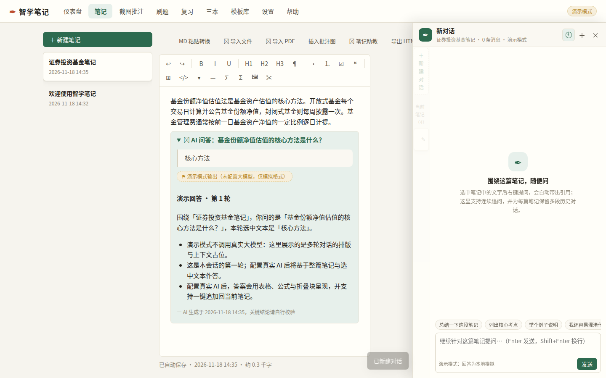

# Dogfood Report: 智学笔记 · 笔记助教对话栏

| Field | Value |
|-------|-------|
| **Date** | 2026-11-18 |
| **App URL** | http://127.0.0.1:8899 |
| **Session** | notechat-ad45f54631b6 |
| **Scope** | 选中文本提问、多轮追问、多会话/历史会话、重新生成、追加到笔记、刷新持久化、窄屏布局、真实 API 内容块模拟、控制台错误 |

## Summary

| Severity | Count |
|----------|-------|
| Critical | 0 |
| High | 0 |
| Medium | 0 |
| Low | 1 |
| **Total** | **1** |

已发现并修复 1 个低优先级 UX 问题；其余核心流程均通过，浏览器控制台与页面错误日志为空。

## Verified Flows

| 流程 | 结果 | 证据 |
|------|------|------|
| 笔记中创建内容并选中文字 | 通过 | `screenshots/02-notes.png`, `03-context-menu.png` |
| 右键菜单打开右侧对话栏并带出引用 | 通过 | `screenshots/04-drawer-open.png` |
| 首轮提问与演示回答 | 通过，`第 1 轮` | `screenshots/05-first-answer.png` |
| 追问与轮次编号 | 通过，`第 2 轮`，前文被识别 | `screenshots/06-two-turns.png` |
| 历史会话列表、新建第二段会话 | 通过 | `screenshots/08-two-sessions.png`, `10-history-visible.png` |
| 切换历史会话恢复消息 | 通过，恢复 2 问 2 答 | `screenshots/11-switch-session.png` |
| 重新生成第一轮回答 | 通过，消息顺序保持正确 | `screenshots/12-retry-first.png` |
| 追加回答到笔记 | 通过，笔记内容出现 AI 问答块 | `screenshots/13-append-to-note.png` |
| 窄屏 390×844 布局 | 通过，无横向滚动，抽屉占满屏宽 | `screenshots/14-mobile-drawer.png` |
| 刷新后持久化 | 通过，2 段会话与消息仍在 | `screenshots/15-after-reload.png` |
| 真实 API 内容块模拟 | 通过，输出正常文本，无 `[object Object]` | 浏览器内 eval 结果 |
| 真实平台连通（dots3-note-prev） | 通过，返回 `连接成功` | 本地代理 `/api/ai/chat` |
| 真实平台笔记提问 | 通过，返回正常中文回答，无 `[object Object]` | `screenshots/18-live-api-answer.png` |
| 真实平台多轮追问 | 通过，第二轮正确引用上一轮上下文 | `screenshots/19-live-multi-turn.png` |
| 长期记忆压缩（14 条历史） | 通过，压缩 4 条旧消息并生成结构化摘要 | `screenshots/20-memory-summary.png` |
| 摘要驱动的上下文追问 | 通过，偏好消息已被压缩且未被召回，回答仍准确使用摘要 | `screenshots/21-memory-context-answer.png` |
| 摘要查看弹窗 | 通过 | `screenshots/22-memory-view.png` |

## Issues

### ISSUE-001: toast 临时遮挡对话栏顶部操作按钮

| Field | Value |
|-------|-------|
| **Severity** | low |
| **Category** | ux / functional |
| **URL** | http://127.0.0.1:8899/#notes |
| **Repro Video** | N/A |

**Description**

对话栏展开时，全局 toast 仍固定在右上角 `top:64px; right:20px`，正好覆盖对话栏头部的「历史 / 新建 / 关闭」按钮。新建对话等操作会弹出 toast，用户立即点击历史按钮时会被 toast 拦截，需等待提示自动消失。预期 toast 不应遮挡可操作控件。

**Repro Steps**

1. 打开笔记页，点击「💬 笔记助教」展开右侧对话栏。
   

2. 在对话栏中点击头部「＋」新建对话，出现 toast。
   

3. 立即点击头部「🕘」历史按钮，agent-browser 报告按钮被 `div.toast` 覆盖，点击未生效。

4. 等待约 2 秒后 toast 消失，按钮恢复可点击。

**Fix**

`body.chat-open` 时把 toast 移到对话栏左侧底部；窄屏下移到视口右下角。

```css
body.chat-open .toast-wrap { top: auto; bottom: 20px; right: min(480px, 40vw); }
@media (max-width: 700px) {
  body.chat-open .toast-wrap { right: 12px; bottom: 12px; }
}
```

**Verification**

修复后连续点击「新建对话」和「历史」均无遮挡，toast 顶部坐标 837.7、对话栏头部底部 112，不再重叠。


---
