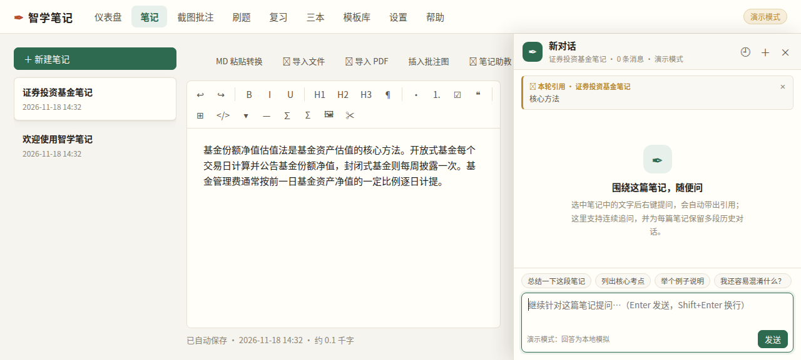
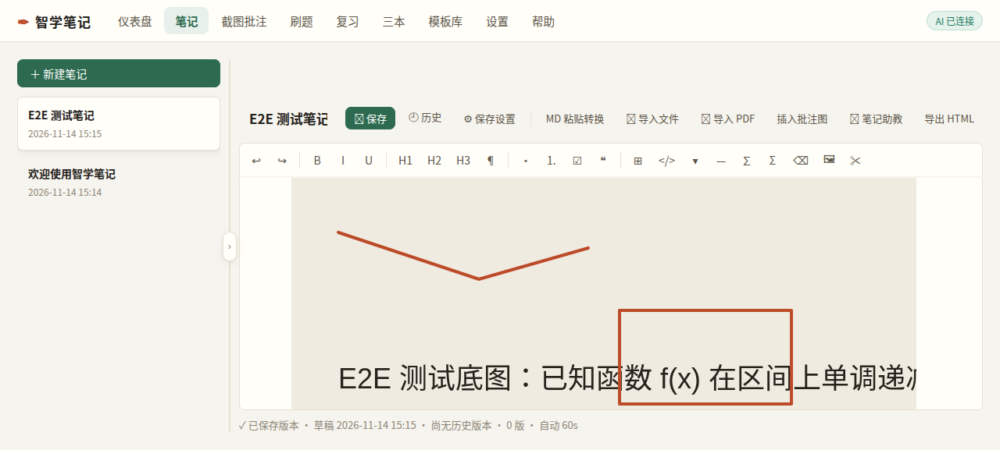
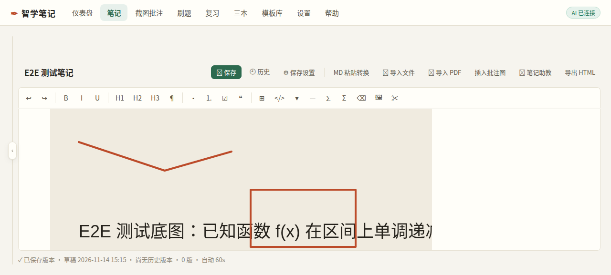
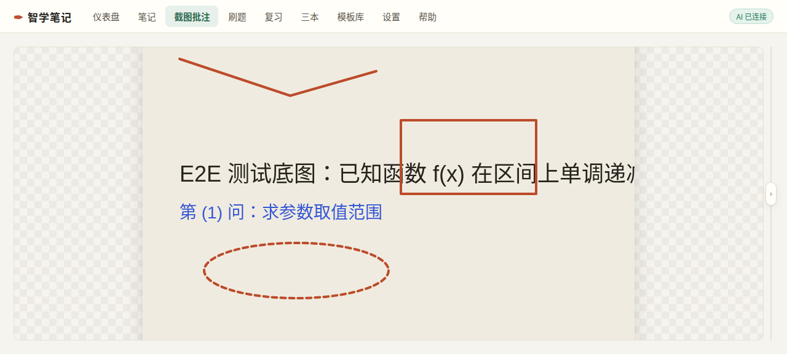

# Dogfood Report: 智学笔记 · 笔记助教对话栏

| Field | Value |
|-------|-------|
| **Date** | 2026-11-20 |
| **App URL** | http://127.0.0.1:8899 |
| **Session** | notechat-ad45f54631b6 / displayaudit-ad45f54631b6 |
| **Scope** | 选中文本提问、多轮追问、多会话/历史会话、长期记忆压缩、笔记手动/自动保存、版本历史与回退、永久保存与清理、按选中位置插入 AI 批注、悬浮可编辑批注、分栏折叠/拖拽、弹窗缩放、多尺寸避让、全页面显示 bug 巡检、真实 API、控制台错误 |

## Summary

| Severity | Count |
|----------|-------|
| Critical | 0 |
| High | 0 |
| Medium | 1 |
| Low | 1 |
| **Total** | **2** |

已发现并修复 1 个低优先级 UX 问题；其余核心流程均通过，浏览器控制台与页面错误日志为空。

## Verified Flows

| 流程 | 结果 | 证据 |
|------|------|------|
| 笔记中创建内容并选中文字 | 通过 | `screenshots/02-notes.png`, `03-context-menu.png` |
| 右键菜单打开右侧对话栏并带出引用 | 通过 | `screenshots/04-drawer-open.png` |
| 首轮提问与演示回答 | 通过，`第 1 轮` | `screenshots/05-first-answer.png` |
| 追问与轮次编号 | 通过，`第 2 轮`，前文被识别 | `screenshots/06-two-turns.png` |
| 历史会话列表、新建第二段会话 | 通过 | `screenshots/08-two-sessions.png`, `10-history-visible.png` |
| 切换历史会话恢复消息 | 通过，恢复 2 问 2 答 | `screenshots/11-switch-session.png` |
| 重新生成第一轮回答 | 通过，消息顺序保持正确 | `screenshots/12-retry-first.png` |
| 追加回答到笔记 | 通过，笔记内容出现 AI 问答块 | `screenshots/13-append-to-note.png` |
| 窄屏 390×844 布局 | 通过，无横向滚动，抽屉占满屏宽 | `screenshots/14-mobile-drawer.png` |
| 刷新后持久化 | 通过，2 段会话与消息仍在 | `screenshots/15-after-reload.png` |
| 真实 API 内容块模拟 | 通过，输出正常文本，无 `[object Object]` | 浏览器内 eval 结果 |
| 真实平台连通（dots3-note-prev） | 通过，返回 `连接成功` | 本地代理 `/api/ai/chat` |
| 真实平台笔记提问 | 通过，返回正常中文回答，无 `[object Object]` | `screenshots/18-live-api-answer.png` |
| 真实平台多轮追问 | 通过，第二轮正确引用上一轮上下文 | `screenshots/19-live-multi-turn.png` |
| 长期记忆压缩（14 条历史） | 通过，压缩 4 条旧消息并生成结构化摘要 | `screenshots/20-memory-summary.png` |
| 摘要驱动的上下文追问 | 通过，偏好消息已被压缩且未被召回，回答仍准确使用摘要 | `screenshots/21-memory-context-answer.png` |
| 摘要查看弹窗 | 通过 | `screenshots/22-memory-view.png` |
| 新版笔记工具栏 | 通过，保存/历史/保存设置分组清晰 | `screenshots/23-new-toolbar.png` |
| 手动保存版本 | 通过，生成 1 个手动版本并更新状态栏 | `screenshots/24-manual-save.png` |
| 可配置自动保存 | 通过，设为 1 秒后自动生成版本 | `screenshots/25-auto-save.png` |
| 版本历史列表 | 通过，展示来源、时间、字符数与操作 | `screenshots/26-history-list.png` |
| 永久保存版本 | 通过，标记为 🔒 且不被数量清理 | `screenshots/27-pin-version.png` |
| 历史版本回退 | 通过，恢复内容并生成 restore 版本 | `screenshots/28-restore-version.png` |
| 版本数量清理 | 通过，仅保留 3 个普通版本，永久版本未受影响 | `screenshots/29-prune-versions.png` |
| 删除永久保存版本 | 通过，确认后可删除 | `screenshots/30-delete-pinned.png` |
| 选中文本提问保留锚点 | 通过，`context.anchor` 已持久化 | `screenshots/31-ask-with-anchor.png` |
| AI 批注插入原文下方 | 通过，插入目标段落之后；原文无 `<mark>` 包裹；CSS Highlight 生效 | `screenshots/32-annotation-inserted.png` |
| 批注默认悬浮折叠 | 通过，卡片默认 `display:none`，只显示标签 | `screenshots/33-hover-collapsed.png` |
| 悬浮展开与富文本渲染 | 通过，展开后表格 1 个、KaTeX 公式 2 个，与笔记/对话栏同款样式 | `screenshots/34-hover-expanded.png` |
| 悬浮内容直接编辑 | 通过，修改后自动写入笔记，表格结构保留 | `screenshots/35-hover-edited.png` |
| 笔记侧栏拖拽 | 通过，260px → 343px 并写入本地偏好 | `screenshots/37-pane-resized.png` |
| 笔记侧栏折叠/展开 | 通过，网格变为 `0 8px 1fr`，侧栏隐藏 | `screenshots/38-pane-collapsed.png` |
| 900px 对话栏避让 | 通过，正文右边界 418px < 抽屉左边界 440px | `screenshots/39-chat-900.png` |
| 760px 对话栏避让 | 通过，正文右边界 353px < 抽屉左边界 365px | `screenshots/40-chat-760.png` |
| AI 对话栏拖拽 | 通过，460px → 540px 并写入本地偏好 | `screenshots/41-chat-resized.png` |
| 批注页右侧栏拖拽/折叠 | 通过，300px → 378px，折叠后网格右侧归零 | `screenshots/42-annot-panes.png`, `43-annot-collapsed.png` |
| 刷题页侧栏折叠 | 通过 | `screenshots/44-quiz-collapsed.png` |
| 弹窗右下角缩放 | 通过，780×275 → 862×338 | `screenshots/45-modal-resized.png` |
| 长笔记滚动工具栏保持可见 | 通过，编辑器滚动 1686px，工具栏 top 始终 183px，页面无整体滚动 | `screenshots/46-notes-toolbar-sticky.png` |
| 刷题页标签栏吸顶 | 通过，滚动 562px 后 tab top = 54px | `screenshots/47-quiz-tabs-sticky.png` |
| 三本筛选区吸顶 | 通过，滚动 600px 后 sticky-head top = 54px | `screenshots/48-books-sticky.png` |
| 模板库筛选区吸顶 | 通过，滚动 600px 后 sticky-head top = 54px | `screenshots/49-templates-sticky.png` |
| 窄屏顶栏动态高度 | 通过，顶栏实际 90px，`--topbar-h` 同步为 90px | `screenshots/50-mobile-toolbar.png` |
| 批注页工具区 | 通过，页面不整体滚动，工具区在固定视口内独立滚动 | N/A |

## Issues

### ISSUE-001: toast 临时遮挡对话栏顶部操作按钮

| Field | Value |
|-------|-------|
| **Severity** | low |
| **Category** | ux / functional |
| **URL** | http://127.0.0.1:8899/#notes |
| **Repro Video** | N/A |

**Description**

对话栏展开时，全局 toast 仍固定在右上角 `top:64px; right:20px`，正好覆盖对话栏头部的「历史 / 新建 / 关闭」按钮。新建对话等操作会弹出 toast，用户立即点击历史按钮时会被 toast 拦截，需等待提示自动消失。预期 toast 不应遮挡可操作控件。

**Repro Steps**

1. 打开笔记页，点击「💬 笔记助教」展开右侧对话栏。
   

2. 在对话栏中点击头部「＋」新建对话，出现 toast。
   

3. 立即点击头部「🕘」历史按钮，agent-browser 报告按钮被 `div.toast` 覆盖，点击未生效。

4. 等待约 2 秒后 toast 消失，按钮恢复可点击。

**Fix**

`body.chat-open` 时把 toast 移到对话栏左侧底部；窄屏下移到视口右下角。

```css
body.chat-open .toast-wrap { top: auto; bottom: 20px; right: min(480px, 40vw); }
@media (max-width: 700px) {
  body.chat-open .toast-wrap { right: 12px; bottom: 12px; }
}
```

**Verification**

修复后连续点击「新建对话」和「历史」均无遮挡，toast 顶部坐标 837.7、对话栏头部底部 112，不再重叠。


---

### ISSUE-002: 折叠侧栏后主内容被挤进 8px 手柄列

| Field | Value |
|-------|-------|
| **Severity** | medium |
| **Category** | functional / layout |
| **URL** | http://127.0.0.1:8899/#notes |

**Description**

折叠笔记列表后，侧栏由 `display:none` 退出 Grid，但容器仍使用三列模板 `0 8px 1fr`。浏览器自动排列时把 8px 手柄放入第一列、主编辑区放入第二列（仅 8px 宽），导致笔记正文看起来“消失”。右侧批注工具栏折叠时同理。预期折叠后主内容应占满剩余宽度。

**Repro Steps**

1. 打开笔记页，点击笔记列表分栏手柄上的折叠按钮。
   

2. 折叠后主编辑区宽度从 952px 变成 54px、高度 46px，正文不可见。
   

**Fix**

折叠时改用两列 Grid：左侧栏折叠为 `8px minmax(0,1fr)`；右侧栏折叠为 `minmax(0,1fr) 8px`。侧栏仍用 `display:none` 隐藏，但不再留下空列参与自动排列。

**Verification**

折叠后笔记编辑区宽度为 1220px、高度 352px；展开后恢复 260px 侧栏 + 952px 编辑区，笔记列表 2 条和正文均完整显示。批注页与刷题页同样验证通过。




---

## 第二轮：全页面显示 bug 全面审查（2026-11-20）

| Field | Value |
|-------|-------|
| **Session** | displayaudit-ad45f54631b6 |
| **工具** | agent-browser（CDP）· 6 种视口 × 9 个页面 + 折叠/对话栏/弹窗/滚动状态 |
| **视口** | 1440×900 / 1000×800 / 900×800 / 760×800 / 390×844 / 320×700 |

本轮用脚本遍历全部页面，检测 `documentElement.scrollWidth > clientWidth` 的横向溢出、越界元素、折叠态可达性、长图滚动可达性、弹窗/对话栏层级、sticky 吸顶、控制台错误。共发现并修复 9 个问题，复测后 **6 种视口 × 9 页面全部无横向溢出，控制台错误为空**。

### 本轮修复清单

| # | 问题 | 现象 | 修复 |
|---|------|------|------|
| 1 | 仪表盘 KaTeX 横向溢出 | 390/320px 下最近作答的公式读屏 MathML（`position:absolute`）脱离包含块，把页面撑到 469px | `.katex { position: relative }` + `body { overflow-x: clip }`；考点掌握度行改 `flex-wrap` 且 chip `min-width` 110px |
| 2 | 折叠侧栏窄屏无法恢复 | 桌面折叠后持久化，≤900px 手柄隐藏，侧栏 `display:none` 永久不可见 | ≤900px 媒体查询内覆盖 `.pane-collapsed [data-pane=side]` 恢复 `display`，侧栏始终可见 |
| 3 | 截图批注长图顶部不可达 | `.annot-stage` 用 flex 居中，底图高于舞台时顶部落在负滚动区，`scrollTop=0` 仍看不到 | 改为 `display:grid; place-items:center` + 子元素 `margin:auto`，内容更大时退化为起点对齐 |
| 4 | 弹窗内右键提问对话栏被遮罩 | ctx-menu(260) 高于 modal(200) 可点击，但 drawer(120) 被 modal 覆盖无法操作 | `openAsk` 打开对话栏前先关闭所有 modal |
| 5 | 手绘板固定 760px 横向溢出 | 主栏宽度 < 760px 时画布撑破布局 | `.draw-canvas-wrap canvas { max-width:100%; height:auto }`，坐标换算已按 `canvas.width/rect.width` 比例 |
| 6 | 满高布局窄屏底部留白 | `notes-layout`/`annot-layout` 固定减 44px（桌面 padding），窄屏 padding 14px 导致底部多留 16px | 引入 `--view-pad` 变量，满高布局减 `--view-pad * 2`，媒体查询同步 |
| 7 | AI 悬浮批注卡片越界/被裁剪 | 靠近编辑区右缘或底部时卡片被 `overflow` 裁剪 | `notes.js` 新增按编辑区可视框的像素级钳制（左右/上下），缩放与滚动时重排 |
| 8 | 帮助页表格窄屏溢出 | 帮助文档表格无横向滚动 | ≤700px 下 `.help-doc table` 可横向滚动；设置栅格单列化 |
| 9 | 顶栏高度变更未同步 | 窄屏顶栏换行后 sticky 偏移依赖窗口 resize 事件 | 保留 `updateTopbarHeight()`，配合 `--view-pad` 变量统一偏移 |

### 复测结果

| 检查项 | 结果 | 证据 |
|--------|------|------|
| 6 视口 × 9 页面横向溢出 | 全部通过（无 `scrollWidth > clientWidth`） | 脚本巡检输出 |
| 折叠侧栏后主内容占满 | 通过，窄屏侧栏始终可见 | `screenshots/56-notes-collapsed-main-ok.png` |
| 长图顶部可达 | 通过，`scrollTop=0` 时底图 top 相对舞台为 +17px | `screenshots/57-annot-tall-image-top-reachable.png` |
| 320px 仪表盘不溢出 | 通过，`scrollWidth = clientWidth = 320` | `screenshots/58-dashboard-320-no-overflow.png` |
| AI 卡片对话栏打开时不越界 | 通过，卡片右缘 410 < 编辑区右缘 418 | `screenshots/59-ai-card-clamped-chat-open.png` |
| 900px 手绘板不溢出 | 通过，画布 760→等比缩放 | `screenshots/60-quiz-draw-canvas-900.png` |
| 弹窗内右键提问 | 通过，弹窗关闭、对话栏打开 | 浏览器 eval |
| sticky 工具栏/标签/筛选区 | 通过，滚动后 tabs top=54=顶栏高 | 浏览器 eval |
| 控制台错误 | 无 | `window.error` + `unhandledrejection` 捕获为 `[]` |

---

## 第三轮：笔记批注增强与工具图标美化（2026-11-20）

| Field | Value |
|-------|-------|
| **Session** | displayaudit-ad45f54631b6 |
| **范围** | 多色高亮、文字颜色、删除线/上下标/链接/行内代码、Markdown `==高亮==`、SVG 线性图标、消毒与导出兼容、全页面回归 |

在笔记工具栏新增悬浮色板与多种 HTML 批注能力，并把笔记/批注页的操作图标统一为 Lucide 风格内联 SVG。

### 实现要点

| 能力 | 实现 | 兼容处理 |
|------|------|----------|
| 多色高亮 | 高亮按钮弹出 8 色色板（含「清除高亮」），`execCommand('hiliteColor')` + `styleWithCSS` | 产出 `background-color` 内联样式，消毒白名单保留 `style`，导出 HTML 原样保留 |
| 文字颜色 | 6 色悬浮色板，`execCommand('foreColor')` | 同上，`color` 内联样式保留 |
| 更多 HTML 批注 | 删除线、上标、下标、插入链接、行内代码 | `s/sup/sub/a/code` 均已在消毒白名单；为 `a` 补 `rel` 保证 `noopener` |
| Markdown 高亮 | 两条渲染路径均支持 `==高亮==` → `<mark>` | `looksLikeMd` 同步识别，粘贴自动转换 |
| 图标美化 | 新增 `js/core/icons.js`（内联 SVG 集）；笔记工具栏 29 按钮、页面头部 7 按钮、批注工具 9 按钮全部 SVG 化 | 无外部图标库、无 emoji；`index.html` 在视图脚本前引入 |
| 导出独立 HTML | 补齐 mark/del/sup/sub/a/code/待办/折叠块/hr 样式 | 高亮与批注在脱离应用后仍正确呈现 |

### 复测结果

| 检查项 | 结果 | 证据 |
|--------|------|------|
| 图标加载（29 按钮均 SVG、无 emoji 回退） | 通过 | `screenshots/61-notes-svg-toolbar.png`、`62-notes-toolbar-clean.png` |
| 高亮色板弹出与选色 | 通过，8 色 + 清除，应用后产出 `background-color` | `screenshots/63-highlight-palette.png` |
| 多色高亮实际渲染 | 通过，绿色高亮正确显示 | `screenshots/64-highlight-applied.png` |
| 文字颜色 / 删除线 / 上下标 / 链接 | 通过，产出标准内联样式与语义标签 | 浏览器 eval |
| `==高亮==` Markdown | 通过，输出 `<mark>高亮文字</mark>` | 浏览器 eval |
| 消毒保留高亮/颜色/安全链接 | 通过，`style`/`mark`/`rel` 均保留 | 浏览器 eval |
| 高亮保存后刷新仍在 | 通过，`background-color` 持久化 | 浏览器 eval |
| 色板点击外部关闭 | 通过，真实 pointerdown 后 `hidden=true` | 浏览器 eval |
| 批注页图标 SVG 化 | 通过，9 个工具均 SVG、无 emoji | `screenshots/65-annotator-svg-tools.png` |
| 6 视口 × 9 页面横向溢出 | 全部 ALL_OK | 脚本巡检 |
| 控制台错误 | 无 | `window.error` + `unhandledrejection` 捕获为 `[]` |

---

## 第四轮：笔记标题/首行遮挡与空间利用（2026-11-20）

| Field | Value |
|-------|-------|
| **Session** | displayaudit-ad45f54631b6 |
| **范围** | 笔记标题显示、正文首行遮挡、工具栏空间压缩、全页面空间利用审计 |

### 根因与修复

| 问题 | 根因 | 修复 |
|------|------|------|
| 笔记标题被挤成 73px，只显示「E2E 测」 | `.note-title-input` 为 `flex:1;min-width:0`，被右侧 10 个操作按钮挤压 | 标题改 `flex:1 1 200px;min-width:200px;text-overflow:ellipsis`，操作区改 `flex:1 1 320px;min-width:0`，宽屏同排、窄屏各自换行 |
| 正文第一行被工具栏盖住 | `.note-editor-top` 为 `position:sticky;top:var(--topbar-h)`，但其父容器 `.notes-editor` 是 `overflow:hidden` 且自身不滚动（只有 `#editor-area` 内部滚动），sticky 偏移 54px 导致头部 bottom 比编辑区 top 低 54px，正好盖住首行 | 改为 `position:static`（编辑区之外，滚动时天然常驻），加 `flex:0 0 auto` |
| 工具栏第二行仅 3 个按钮，浪费 35px 垂直空间 | 29 个按钮按原间距换行成 26+3 | 按钮 padding 7→5、min-width 30→26、gap 3→2、分隔符 margin 收窄，1440 宽下 29 按钮落在同一行，工具栏 76→41px，编辑区多出 14px |

### 复测结果

| 检查项 | 结果 | 证据 |
|--------|------|------|
| 标题完整显示（411px，无截断），各宽度不截断 | 通过 | `screenshots/66-notes-title-firstline-fixed.png`、`68-notes-mobile-title-final.png` |
| 工具栏底与编辑区顶重叠 = 0，首行可见 | 通过 | `screenshots/66` |
| 编辑区滚动时工具栏常驻可见 | 通过，scrollTop=3000 工具栏 top=76 | 浏览器 eval |
| 工具栏单行 29 按钮、编辑区高度 +14px | 通过 | `screenshots/67-notes-title-toolbar-final.png` |
| 6 视口 × 9 页面横向溢出 | 全部 ALL_OK | 脚本巡检 |
| 控制台错误 | 无 | eval 捕获 |

---
